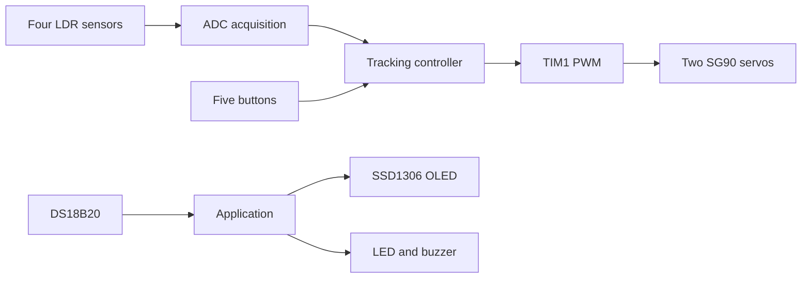

# STM32 Dual-Axis Solar Tracking System

Firmware reconstruction of a dual-axis solar tracker built around the STM32F103C8T6. Four light-dependent resistors (LDRs) estimate the light-source direction, while two SG90 servos adjust the horizontal and vertical axes. The system supports automatic tracking, manual positioning, OLED monitoring, temperature sensing and an over-temperature alarm.

## Features

- Four-channel ADC acquisition with three-sample averaging
- Difference-threshold tracking to prevent continuous servo hunting
- Dual 50 Hz PWM outputs from TIM1 for two SG90 servos
- Automatic and four-direction manual control
- Button debouncing and servo pulse limiting
- SSD1306 128x64 I2C OLED status display
- Asynchronous DS18B20 temperature measurement with CRC checking
- LED and buzzer over-temperature alarm
- Modular STM32Cube HAL firmware suitable for PlatformIO

## System overview



## Repository structure

```text
include/
  app_config.h    Pin mapping and calibration constants
  alarm.h         Alarm output interface
  buttons.h       Debounced button interface
  delay_us.h      DWT microsecond delay interface
  ds18b20.h       Temperature-sensor interface
  font5x7.h       OLED font interface
  ldr.h           Four-channel light-sensor interface
  servo.h         TIM1 PWM servo interface
  ssd1306.h       OLED interface
  tracker.h       Automatic/manual tracking logic
src/
  main.c          Application initialization and scheduler
  alarm.c         LED and buzzer driver
  buttons.c       Active-low button scanning and debounce
  delay_us.c      Cortex-M3 DWT delay implementation
  ds18b20.c       One-wire protocol and temperature conversion
  font5x7.c       Compact display font
  ldr.c           ADC setup, sampling and voltage conversion
  servo.c         50 Hz PWM generation and travel limiting
  ssd1306.c       I2C display driver and framebuffer
  tracker.c       Tracking state machine and direction control
docs/
  code_walkthrough_zh.md  Chinese code walkthrough
  reconstruction_notes.md Source limitations and design decisions
```

## Pin assignment

| Function | STM32F103C8T6 pin | Peripheral |
|---|---:|---|
| Upper LDR | PA0 | ADC1 IN0 |
| Lower LDR | PA1 | ADC1 IN1 |
| Left LDR | PA2 | ADC1 IN2 |
| Right LDR | PA3 | ADC1 IN3 |
| Horizontal servo | PA8 | TIM1 CH1 |
| Vertical servo | PA9 | TIM1 CH2 |
| OLED SCL | PB6 | I2C1 SCL |
| OLED SDA | PB7 | I2C1 SDA |
| DS18B20 data | PB1 | One-wire GPIO |
| Buzzer | PB8 | GPIO output |
| Alarm LED | PB9 | GPIO output |
| Mode button | PB10 | GPIO input, pull-up |
| Up button | PB12 | GPIO input, pull-up |
| Right button | PB13 | GPIO input, pull-up |
| Left button | PB14 | GPIO input, pull-up |
| Down button | PB15 | GPIO input, pull-up |

## Electrical notes

- Power the SG90 servos from a separate regulated 5 V supply; do not power both servos from the Blue Pill 3.3 V rail.
- Connect the servo supply ground and STM32 ground together.
- Add a 4.7 kOhm pull-up resistor between the DS18B20 data line and 3.3 V.
- Build each LDR as a voltage divider whose output remains within the 0-3.3 V ADC range.
- Confirm the OLED address. `app_config.h` uses the common address `0x3C`.
- Use an ST-Link programmer and keep SWDIO/SWCLK available.

## Build and upload

1. Install [Visual Studio Code](https://code.visualstudio.com/) and the PlatformIO extension.
2. Open the repository folder in PlatformIO.
3. Connect the Blue Pill through ST-Link.
4. Build the firmware:

   ```bash
   pio run
   ```

5. Upload the firmware:

   ```bash
   pio run --target upload
   ```

## Calibration

All hardware-dependent settings are kept in `include/app_config.h`.

- `LDR_DIFF_THRESHOLD_CV`: light-difference deadband in centivolts.
- `LDR_HIGHER_READING_IS_BRIGHTER`: set to `0` if brighter light lowers the ADC voltage.
- `SERVO_MIN_US`, `SERVO_CENTER_US`, `SERVO_MAX_US`: safe PWM pulse limits.
- `SERVO_STEP_US`: movement applied during each control update.
- `TEMPERATURE_ALARM_C`: over-temperature alarm threshold.

If either axis moves away from the light, swap the corresponding LDR inputs, reverse the servo linkage, or invert the direction in `tracker.c`.

## Reconstruction scope

The thesis appendix contained only the application-level main program. The control behaviour, three-sample ADC averaging, automatic/manual modes, light-difference threshold and original 1750-1950 microsecond servo limits were retained. Peripheral drivers, pin corrections, button debounce, CRC validation and non-blocking temperature acquisition were reconstructed to produce a complete modular firmware example. See `docs/reconstruction_notes.md` for details.

## Current verification status

The source has been reviewed for module consistency and STM32 HAL API usage. Hardware verification is still required because the original document did not provide complete schematics, driver source files or an exact wiring table for every peripheral.
